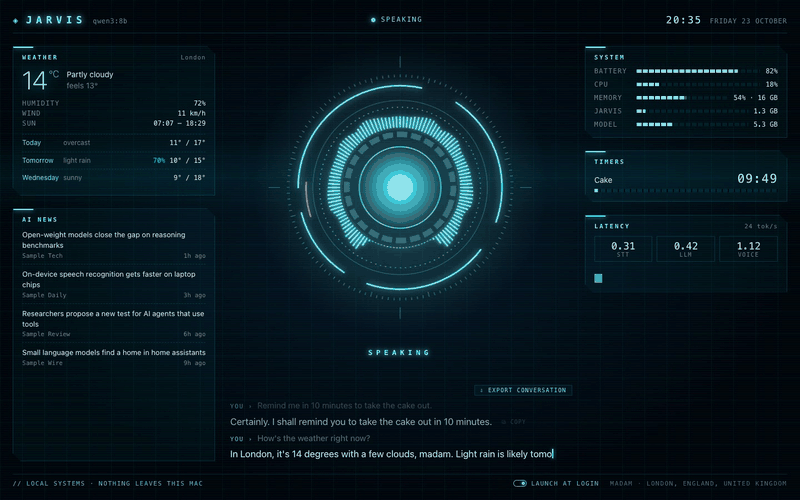
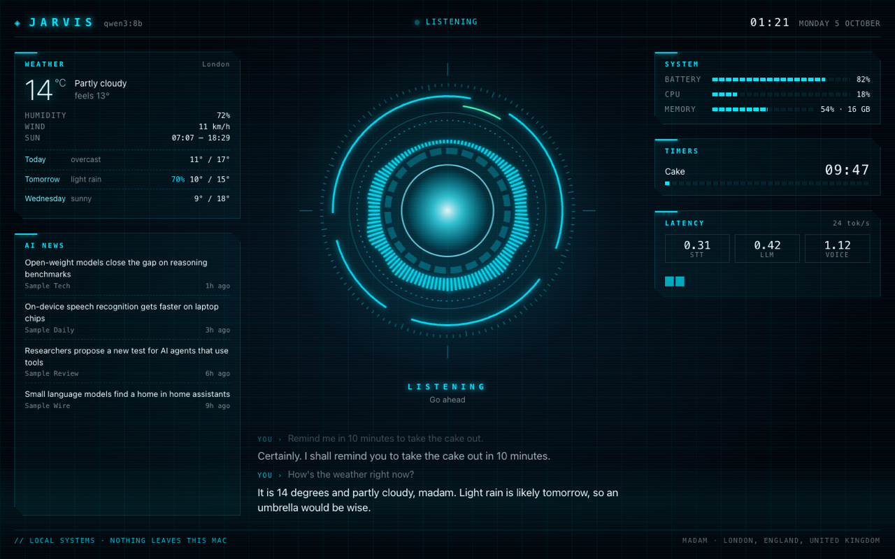
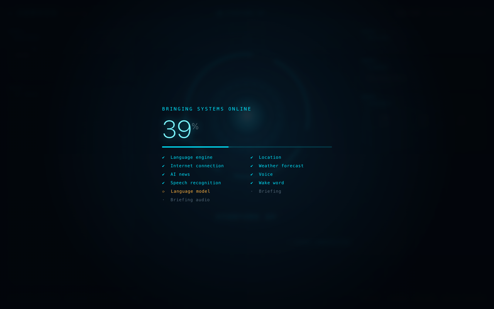
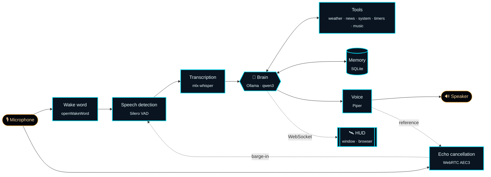

<div align="center">



<br>


**English** · [Português (Brasil)](README.pt-BR.md)

**A voice assistant that lives on your Mac, not in someone else's data center.**<br>
Language model, speech recognition and voice all run on-device: no API keys, no tokens, no cloud.

[Overview](#-overview) · [Features](#-features) · [HUD](#-hud) · [Architecture](#-architecture) · [Quick start](#-quick-start) · [Configuration](#-configuration) · [Performance](#-performance) · [Roadmap](#-roadmap)

<br>



<sub>The HUD running a scripted conversation (<code>hud-demo --sample</code>): wake, set a timer, ask for the weather.</sub>

</div>

<br>

## ◈ Overview

Jarvis is a personal assistant you talk to. Say **"Hey Jarvis"**, ask a question or give an instruction, and it answers out loud in about a second, in the manner of a British butler. It checks the weather and the AI news, plays music on Spotify, sets timers, controls the Mac and remembers what you ask it to, while a holographic HUD shows what it is doing.

Everything that understands or produces language runs locally on Apple Silicon:

| Stage | Runs on | Model |
|---|---|---|
| Wake word | CPU (ONNX) | openWakeWord `hey_jarvis` |
| Speech detection | CPU | Silero VAD |
| Transcription | GPU (MLX) | `whisper-small` |
| Reasoning and tools | GPU (Metal, via Ollama) | `qwen3:8b` |
| Voice | CPU | Piper (`en_GB-alan` · `pt_BR-faber`) |

Only weather (Open-Meteo) and news (RSS) reach the internet, through free APIs that need no key, plus Spotify when you ask for music. Personal settings live in a git-ignored `.env`.

## ◈ Features

<table>
  <tr>
    <td width="33%" valign="top">
      <h3>🎙️ Voice-first</h3>
      Wake word, speech recognition and a natural voice, all on-device. Replies are spoken sentence by sentence while the rest is still being generated.
    </td>
    <td width="33%" valign="top">
      <h3>🔒 Private by design</h3>
      Conversations, memory and audio never leave your Mac. No accounts, no API keys, no telemetry.
    </td>
    <td width="33%" valign="top">
      <h3>🎩 A butler's manners</h3>
      Formal, polite and dry-witted. Addresses you by the name and title you choose, with correct grammatical gender.
    </td>
  </tr>
  <tr>
    <td valign="top">
      <h3>🌦️ Daily briefing</h3>
      On the day's first start, a loading screen fetches the local weather and the AI headlines that matter, and Jarvis speaks the whole briefing at 100%. Later starts open quietly.
    </td>
    <td valign="top">
      <h3>🎵 Music by voice</h3>
      "Play Stray Kids on Spotify" starts the song in about 3 seconds, with no account or API key. Pause, skip, ask what's playing, turn it up or down.
    </td>
    <td valign="top">
      <h3>🛰️ Holographic HUD</h3>
      An original interface in its own window: rings that react to both voices, replies typed in step with speech, and live panels for weather, news, system, timers and latency.
    </td>
  </tr>
  <tr>
    <td valign="top">
      <h3>🧠 Long-term memory</h3>
      Ask it to remember something and it knows it in every conversation after that. List or delete what it keeps at any time.
    </td>
    <td valign="top">
      <h3>🗣️ Interruptible</h3>
      Echo cancellation removes Jarvis's own voice from the microphone, so you can cut in mid-sentence without headphones.
    </td>
    <td valign="top">
      <h3>🔁 Always there, lightly</h3>
      Starts with your Mac and waits for "Hey Jarvis". Asleep, it releases the models: about 0.5 GB instead of 7 GB.
    </td>
  </tr>
</table>

## ◈ HUD

<div align="center">

</div>

<br>

When `voice` starts, the HUD opens in its own window. It is served by Jarvis itself at <http://127.0.0.1:8765>, so it also works in a browser tab, on another monitor or in full screen.

| Element | What it does |
|---|---|
| **Loading screen** | Shows each startup step as it really finishes (models, location, weather, news, briefing), then fades out at 100% as Jarvis speaks |
| **Core** | Dim while asleep, cyan while listening, amber and fast while thinking, bright while speaking; the bar ring follows the loudness of each voice |
| **Transcript** | Your words, and the reply typed letter by letter in step with the voice, with the tool in use ("checking the weather") |
| **Panels** | Weather, clickable AI headlines, battery/CPU/memory, memory held by Jarvis and its model, timers, and per-reply latency |
| **Controls** | Copy a reply, export the conversation as Markdown, toggle launch at login |

Click the core or press <kbd>Space</kbd> to wake Jarvis (or send it back to sleep), <kbd>F</kbd> for full screen, and <kbd>⌘</kbd><kbd>Q</kbd> to quit Jarvis along with the window.

<div align="center">

</div>

To try the interface without a microphone or models, run `uv run python -m backend hud-demo` (`--sample` uses fixed, offline panel data).

## ◈ Architecture



A single asyncio process runs the whole pipeline, driven by a state machine (`sleeping → listening → thinking → speaking`). The model's output is split into sentences and synthesized while it is still generating, which is what brings the first spoken word under the 2-second target. The HUD server (FastAPI) runs on the same event loop and receives events over an in-process bus; the native window is a pywebview child process.

Design choices that keep a small local model reliable:

- **Code decides what must be exact.** The weather sentence of the briefing, time arithmetic, goodbyes and memory writes are handled in code; the model chooses tools and phrases replies.
- **Latency is engineered, not hoped for.** The system prompt is pre-loaded, the prompt cache is warmed after each turn, and a spoken "One moment" covers slow tools.
- **Measure before choosing.** Models were picked by benchmarks on the target hardware, not by reputation (`bench`, `bench-stt`).

```
backend/
├── audio/       capture, wake word, VAD, Whisper, Piper, echo cancellation
├── brain/       Ollama client, conversation and tool loop, persona, briefing
├── tools/       weather, news, system, timers, clock, memory, Spotify
├── hud/         event bus, FastAPI server, panel feeds, native window, demo
├── memory/      SQLite history and long-term facts, Markdown export
└── voice.py     the voice loop and startup
frontend/        HUD: Vite + TypeScript, canvas 2D, no framework
tests/           pytest suite (no microphone or models needed)
```

## ◈ Quick start

> [!NOTE]
> Requires macOS on Apple Silicon (16 GB of memory recommended) and [Homebrew](https://brew.sh). uv installs Python 3.12 automatically. Developed and tested on a MacBook Air M4, 16 GB, macOS 26.

```bash
git clone https://github.com/MichelleBudri/my-jarvis.git && cd my-jarvis
cp .env.example .env            # your name, city and language
./scripts/setup.sh              # installs uv and Ollama, pulls the models and voice, runs a health check
uv run python -m backend voice  # say "Hey Jarvis", then ask
```

The setup downloads the language model (`qwen3:8b`, about 5.2 GB), the speech recognition model (`whisper-small`, about 0.5 GB), the Piper voice for your language and the wake word model (about 4 MB), installs Node.js if needed and builds the HUD. On the first run, macOS asks for microphone access.

### Commands

| Command | What it does |
|---|---|
| `uv run python -m backend voice` | Voice conversation with the HUD; briefing on the day's first start (`--no-briefing`, `--no-hud`, `--no-wake` to always listen, `-r` to resume) |
| `uv run python -m backend chat` | Text chat with streaming replies (`-s` reads them aloud, `-r` resumes) |
| `uv run python -m backend autostart install` | Launch at login in the background (`status`, `stop`, `start`, `uninstall`) |
| `uv run python -m backend memory` | List what Jarvis remembers (`memory forget 3`, `memory clear`) |
| `uv run python -m backend doctor` | Health check: Ollama, models, voice, wake word, microphone, location, Spotify |
| `uv run python -m backend hud-demo` | The HUD with a scripted conversation, no microphone or models |
| `uv run python -m backend hud-window` | Reopen the HUD window while Jarvis runs |
| `uv run python -m backend briefing` | Print the briefing with its timings (`-s` reads it aloud) |
| `uv run python -m backend footprint` | Memory held by Jarvis and by its model |
| `uv run python -m backend wake-test` | Live wake word scores, to tune the threshold |
| `uv run python -m backend echo-test` | Measure how much of Jarvis's own voice the microphone still hears |
| `uv run python -m backend bench [models...]` | Compare LLM latency across Ollama models |
| `uv run python -m backend bench-stt [models...]` | Compare Whisper models on one recorded phrase |
| `uv run python -m backend prompt` · `config` | Print the system prompt · the effective configuration |

## ◈ Configuration

Personal settings live in `.env`, which is never committed (see [`.env.example`](.env.example)). Project defaults live in [`config.yaml`](config.yaml); any key can be overridden with an environment variable, using `__` between sections (`JARVIS_LLM__MODEL=qwen3.5:4b`).

| Variable | Example | Effect |
|---|---|---|
| `JARVIS_LANGUAGE` | `en-GB` · `en-US` · `pt-BR` · `es` | Persona, dates, titles, voice and transcription |
| `JARVIS_OWNER_NAME` | `Ada` | Your name |
| `JARVIS_OWNER_GENDER` | `female` · `male` · `neutral` | Default title (madam / sir) and grammatical agreement |
| `JARVIS_OWNER_TITLE` | `madam` · `Dr. Smith` | How Jarvis addresses you; empty uses the default for language and gender |
| `JARVIS_CITY` | `London, England, United Kingdom` | Weather, timezone and season |
| `JARVIS_LATITUDE` · `_LONGITUDE` · `_TIMEZONE` | `51.51` · `-0.13` · `Europe/London` | Optional: skips the city lookup |

<details>
<summary><b>Languages and location</b></summary>
<br>

English and Portuguese are fully supported, including dates, seasons by hemisphere and voices; in English, Jarvis uses the British voice `en_GB-alan-medium`. Other languages use the English prompt with an instruction to reply in the chosen language; set a compatible [Piper voice](https://huggingface.co/rhasspy/piper-voices) in `JARVIS_TTS__VOICE`.

The city is resolved to coordinates and a timezone with the [Open-Meteo geocoding API](https://open-meteo.com/en/docs/geocoding-api) and cached in `data/location.json`. Adding the state or country helps when city names repeat.

</details>

<details>
<summary><b>Tools</b></summary>
<br>

Jarvis calls tools on its own when a request needs live data or an action:

| Tool | Ask things like | Source |
|---|---|---|
| Weather | "How's the weather?" · "Will it rain tomorrow?" · "And in Lisbon?" | [Open-Meteo](https://open-meteo.com) (free, no key) |
| AI news | "Any AI news?" · "Anything about robots?" | RSS feeds in `news.feeds` |
| System | "How much battery is left?" · "Set the volume to 30" · "Open Safari" | macOS (`pmset`, `osascript`, `open`) |
| Timers | "Remind me in 10 minutes to take the cake out" · "Make it 15" · "Cancel the timer" | Local; announced when they end |
| Clock | "How long until 6 pm?" · "How many days until Christmas?" | Local; computed in code |
| Memory | "Remember that I take my coffee black" · "Actually, with milk" · "Forget that" | Local (`data/jarvis.db`) |
| Music | "Play Stray Kids on Spotify" · "Next" · "Pause" · "What's playing?" · "Turn the music up" | The Spotify app |

Slow tools are covered by a spoken "One moment". Goodbyes ("that's all", "you can rest") and a plain "thank you" are answered by code, and goodbyes send Jarvis back to sleep. Enable or disable tools with `tools.enabled` (`JARVIS_TOOLS__ENABLED='["weather", "timers"]'`). Timers are kept in memory and cleared when Jarvis quits.

</details>

<details>
<summary><b>Music (Spotify)</b></summary>
<br>

Spotify's AppleScript can play, pause, skip and set the volume, but it cannot search. Jarvis therefore opens the app's own search page, locates the green play button of the top result in a screenshot of the window, clicks it, returns the pointer to where it was and confirms through AppleScript that playback started. No Spotify account linking or API key is involved. The top result is Spotify's choice, so name the artist when it matters ("Bohemian Rhapsody by Queen").

| Behaviour | Setting |
|---|---|
| A requested song starts at 75% of Spotify's volume, and Jarvis goes back to sleep without describing it, so the music is heard at once | `media.play_volume` (`null` keeps the current volume) |
| While Jarvis listens and speaks, the music drops to 20% and comes back when it sleeps | `media.duck_to` (`0` turns it off) |
| "Turn the music up/down" moves Spotify's volume by 20; "turn the volume down" changes the Mac's | — |

The first song asks for three permissions for the app running Jarvis, under **System Settings → Privacy & Security**: **Automation** (Spotify and System Events), **Accessibility** (the click) and **Screen Recording** (the screenshot). While a song is being found, Spotify comes to the front for a moment.

</details>

<details>
<summary><b>Voice, wake word and interruptions</b></summary>
<br>

Jarvis sleeps until it hears **"Hey Jarvis"** (a rising chime confirms it; "Ei Jarvis" works too). You can ask in the same breath or wait for the chime. After each reply it keeps listening for 8 seconds, so follow-ups need no wake word; a falling chime means it went back to sleep.

```
sleeping ──"Hey Jarvis"──▶ listening ──speech──▶ thinking ──▶ speaking
    ▲                       │     ▲                              │
    └── silence (6 s) ──────┘     └──── reply done (8 s window) ─┘
```

If it misses you or wakes by itself, run `wake-test` and adjust `JARVIS_WAKEWORD__THRESHOLD` (default 0.5; lower is more sensitive). `JARVIS_WAKEWORD__CHIME=false` silences the chimes.

By default Jarvis is half duplex. `JARVIS_AUDIO__BARGE_IN=true` lets you interrupt it mid-sentence; echo cancellation (WebRTC AEC3) removes everything Jarvis plays from the microphone, so no headphones are needed. `echo-test` measures it in your room: on a MacBook Air at normal volume, speech detection on Jarvis's own voice dropped from 88% of frames to 0%.

Other settings: `JARVIS_VAD__SILENCE_MS` (pause that ends your turn, default 700), `JARVIS_TTS__LENGTH_SCALE` (speaking speed) and `JARVIS_AUDIO__INPUT_DEVICE` / `_OUTPUT_DEVICE`.

</details>

<details>
<summary><b>Briefing</b></summary>
<br>

The briefing is a greeting and today's weather, written by code from the forecast in spoken sentences ("It's 22 degrees out and drizzling... An umbrella would be wise."), followed by the one or two most relevant AI headlines, chosen and retold by the model. It is fully written and synthesized behind the loading screen, so it plays without pauses, about 25 seconds after launch with a cold model.

It plays only on the day's first start (`briefing.once_a_day`), and counts once the headlines were spoken; a start without internet tries again next time. At login, Jarvis waits up to `briefing.network_wait_s` (20 s) for Wi-Fi, and any source slower than `briefing.fetch_timeout_s` (5 s) is left out. Disable it with `JARVIS_BRIEFING__ENABLED=false` or `voice --no-briefing`.

</details>

<details>
<summary><b>Memory</b></summary>
<br>

Jarvis stores a fact only when explicitly asked ("remember that...", "don't forget..."). Questions such as "do you remember how I take my coffee?" never store anything: this is checked in code, because the model occasionally guessed an answer and saved the guess. Corrections replace the old fact. Up to 100 short facts go into every conversation, stored in `data/jarvis.db`. Manage them with `memory`, `memory forget <id>` and `memory clear`, or turn the feature off by removing `memory` from `tools.enabled`.

</details>

<details>
<summary><b>Launch at login</b></summary>
<br>

`autostart install` builds a small `Jarvis.app` in `data/` and installs a LaunchAgent that runs `voice` through it in the background, waits up to 2 minutes for Ollama and restarts Jarvis if it crashes. The app bundle is what makes macOS show "Jarvis" with its own icon (in Activity Monitor, Login Items, the Dock and the permission prompts) instead of "python". Output goes to `data/logs/jarvis.log`. The **Launch at login** switch in the HUD turns it on or off for the next login without stopping the running Jarvis. Only one Jarvis runs at a time. After updating Python (`uv python upgrade`), run `autostart install` again.

</details>

<details>
<summary><b>HUD and network access</b></summary>
<br>

Settings: `hud.enabled`, `hud.window` (`false` opens a browser tab instead), `hud.open_on_start`, and `server.host` / `server.port` (default `127.0.0.1:8765`). If the port is busy, Jarvis runs without the HUD and says so.

The WebSocket accepts only pages served from this address (or the Vite dev server), so other websites open in your browser cannot read the conversation. To open the HUD from another device, set `JARVIS_SERVER__HOST` to the Mac's address; anyone on that network can then open it too.

</details>

<details>
<summary><b>Memory use</b></summary>
<br>

Awake, Jarvis holds about 1.3 GB (speech recognition, voice, wake word and the HUD window) plus about 5.4 GB for `qwen3:8b` in Ollama. `resources.profile` decides what is released while it sleeps:

| Profile | Behaviour |
|---|---|
| `performance` | Everything stays loaded; the first answer is always fast |
| `balanced` (default) | The model and Whisper are unloaded after `resources.idle_minutes` asleep (10) |
| `economy` | They are unloaded as soon as Jarvis goes to sleep |

Unloaded, Jarvis holds about 0.5 GB and the model nothing. Reloading starts the moment it hears "Hey Jarvis"; Whisper is back in 0.3 s, while the model's first answer takes about 15 s longer. Check the numbers with `footprint` or in the HUD.

</details>

## ◈ Performance

Measured on a MacBook Air M4 (16 GB) with `qwen3:8b` and `whisper-small`:

| Metric | Result |
|---|---|
| End of speech → transcription | 0.3 s |
| Transcription → model's first word | 0.3 – 1.0 s (prompt cache warm) |
| End of speech → first spoken word, plain reply | 1.0 – 1.4 s |
| Wake word detection | ~1.2 ms per 80 ms of audio, on CPU |
| "Play …" → music playing | ~3 s (~4 s with Spotify closed) |
| Launch → briefing spoken (cold model) | ~25 s |
| Memory awake · asleep (`economy`) | ~6.7 GB · ~0.5 GB |

Replies that need a network tool take longer (weather ~2 s for the request alone), so Jarvis says "One moment" first. Reproduce the language model and Whisper numbers with `bench` and `bench-stt`.

## ◈ Troubleshooting

| Symptom | Fix |
|---|---|
| Jarvis does not hear you | Allow the microphone for Jarvis (or your terminal) in **Privacy & Security → Microphone**; the log reports when it receives only silence |
| It misses "Hey Jarvis" or wakes by itself | Tune `JARVIS_WAKEWORD__THRESHOLD` with `wake-test` |
| Music does not start | Grant Automation, Accessibility and Screen Recording; after installing launch at login before the music feature, run `autostart install` again |
| No HUD | Another process is using port 8765, or the frontend is not built (`npm --prefix frontend run build`) |
| Anything else | `uv run python -m backend doctor`, then `data/logs/jarvis.log` |

## ◈ Development

```bash
uv run pytest                      # test suite: no microphone, models or network needed
uv run ruff check . && uv run ruff format --check .
npm --prefix frontend run dev      # HUD with hot reload at http://localhost:5173 (with voice or hud-demo running)
```

External services are mocked in the tests. After changing the frontend, rebuild it with `npm --prefix frontend run build`.

## ◈ Roadmap

| | Phase | Status |
|:-:|---|---|
| 0 | Foundation: settings, setup script, health check | ✅ Done |
| 1 | Text chat: streaming LLM, persona, history, personalization | ✅ Done |
| 2 | Voice in and out: VAD, Whisper, streaming Piper, barge-in | ✅ Done |
| 3 | Wake word: "Hey Jarvis", state machine | ✅ Done |
| 4 | Tools: weather, AI news, system, timers | ✅ Done |
| 5 | Activation briefing | ✅ Done |
| 6 | Holographic HUD | ✅ Done |
| 7 | Polish: long-term memory, launch at login, echo cancellation, native HUD window | ✅ Done |
| 8 | Loading screen, memory profiles, launch-at-login switch, typed transcript, copy and export, clickable news | ✅ Done |
| 9 | App control: Spotify by voice, music ducking, briefing once a day; more apps next | 🚧 In progress |

## ◈ Stack

<div align="center">


</div>

## ◈ License

Released under the [MIT License](LICENSE). Jarvis is an independent hobby project and is not affiliated with Marvel or Disney.

<div align="center">
<br>
<sub><code>// SYSTEMS ONLINE · RUNNING ON YOUR MACHINE</code></sub>
</div>
