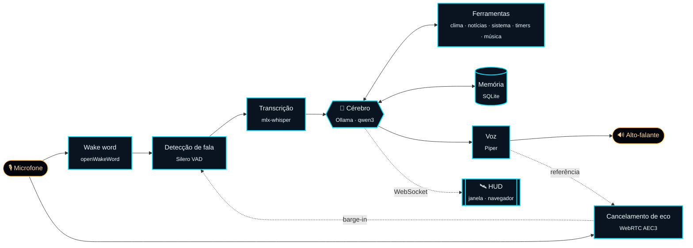

<div align="center">


<br>


[English](README.md) · **Português (Brasil)**

**Um assistente de voz que mora no seu Mac, não no data center de outra pessoa.**<br>
Modelo de linguagem, reconhecimento de fala e voz rodam no próprio aparelho: sem chaves de API, sem tokens, sem nuvem.

[Visão geral](#-visão-geral) · [Recursos](#-recursos) · [HUD](#-hud) · [Arquitetura](#-arquitetura) · [Começo rápido](#-começo-rápido) · [Configuração](#-configuração) · [Desempenho](#-desempenho) · [Roadmap](#-roadmap)

<br>


<sub>A HUD rodando uma conversa roteirizada (<code>hud-demo --sample</code>): acordar, criar um timer, perguntar o clima.</sub>

</div>

<br>

## ◈ Visão geral

O Jarvis é um assistente pessoal com quem você conversa. Diga **"Hey Jarvis"**, faça uma pergunta ou dê uma instrução, e ele responde em voz alta em cerca de um segundo, com os modos de um mordomo britânico. Ele consulta o clima e as notícias de IA, toca música no Spotify, cria timers, controla o Mac e lembra do que você pedir, enquanto uma HUD holográfica mostra o que ele está fazendo.

Tudo o que entende ou produz linguagem roda localmente no Apple Silicon:

| Etapa | Roda em | Modelo |
|---|---|---|
| Wake word | CPU (ONNX) | openWakeWord `hey_jarvis` |
| Detecção de fala | CPU | Silero VAD |
| Transcrição | GPU (MLX) | `whisper-small` |
| Raciocínio e ferramentas | GPU (Metal, via Ollama) | `qwen3:8b` |
| Voz | CPU | Piper (`en_GB-alan` · `pt_BR-faber`) |

Só o clima (Open-Meteo) e as notícias (RSS) chegam à internet, por APIs gratuitas que não exigem chave, além do Spotify quando você pede música. As configurações pessoais ficam num `.env` ignorado pelo git.

## ◈ Recursos

<table>
  <tr>
    <td width="33%" valign="top">
      <h3>🎙️ Voz em primeiro lugar</h3>
      Wake word, reconhecimento de fala e uma voz natural, tudo no aparelho. As respostas são faladas frase a frase enquanto o resto ainda está sendo gerado.
    </td>
    <td width="33%" valign="top">
      <h3>🔒 Privado por padrão</h3>
      Conversas, memória e áudio nunca saem do seu Mac. Sem contas, sem chaves de API, sem telemetria.
    </td>
    <td width="33%" valign="top">
      <h3>🎩 Modos de mordomo</h3>
      Formal, educado e de humor seco. Trata você pelo nome e pelo tratamento que você escolher, com a concordância de gênero correta.
    </td>
  </tr>
  <tr>
    <td valign="top">
      <h3>🌦️ Briefing diário</h3>
      No primeiro início do dia, uma tela de carregamento busca o clima local e as manchetes de IA que importam, e o Jarvis fala o briefing inteiro no 100%. Os inícios seguintes abrem em silêncio.
    </td>
    <td valign="top">
      <h3>🎵 Música por voz</h3>
      "Toque Stray Kids no Spotify" começa a música em cerca de 3 segundos, sem conta nem chave de API. Pause, pule, pergunte o que está tocando, aumente ou abaixe.
    </td>
    <td valign="top">
      <h3>🛰️ HUD holográfica</h3>
      Uma interface original em janela própria: anéis que reagem às duas vozes, respostas digitadas no ritmo da fala e painéis ao vivo de clima, notícias, sistema, timers e latência.
    </td>
  </tr>
  <tr>
    <td valign="top">
      <h3>🧠 Memória de longo prazo</h3>
      Peça para ele lembrar de algo e ele vai saber em todas as conversas seguintes. Liste ou apague o que ele guarda quando quiser.
    </td>
    <td valign="top">
      <h3>🗣️ Pode ser interrompido</h3>
      O cancelamento de eco tira a voz do próprio Jarvis do microfone, então você pode falar por cima dele sem fones.
    </td>
    <td valign="top">
      <h3>🔁 Sempre por perto, sem pesar</h3>
      Inicia com o Mac e espera pelo "Hey Jarvis". Dormindo, libera os modelos: cerca de 0,5 GB em vez de 7 GB.
    </td>
  </tr>
</table>

## ◈ HUD

<div align="center">

</div>

<br>

Quando o `voice` começa, a HUD abre numa janela própria. Ela é servida pelo próprio Jarvis em <http://127.0.0.1:8765>, então também funciona numa aba do navegador, em outro monitor ou em tela cheia.

| Elemento | O que faz |
|---|---|
| **Tela de carregamento** | Mostra cada etapa da inicialização quando ela realmente termina (modelos, localização, clima, notícias, briefing) e some no 100%, quando o Jarvis fala |
| **Núcleo** | Apagado dormindo, ciano escutando, âmbar e rápido pensando, brilhante falando; o anel de barras acompanha o volume de cada voz |
| **Transcrição** | O que você disse, e a resposta digitada letra a letra no ritmo da voz, com a ferramenta em uso ("consultando o clima") |
| **Painéis** | Clima, manchetes de IA clicáveis, bateria/CPU/memória, memória ocupada pelo Jarvis e pelo modelo, timers e latência de cada resposta |
| **Controles** | Copiar uma resposta, exportar a conversa em Markdown, ligar ou desligar o início no login |

Clique no núcleo ou aperte <kbd>Espaço</kbd> para acordar o Jarvis (ou mandá-lo dormir), <kbd>F</kbd> para tela cheia e <kbd>⌘</kbd><kbd>Q</kbd> para encerrar o Jarvis junto com a janela.

<div align="center">

</div>

Para experimentar a interface sem microfone nem modelos, rode `uv run python -m backend hud-demo` (`--sample` usa dados fixos nos painéis, sem internet).

## ◈ Arquitetura



Um único processo asyncio roda o pipeline inteiro, conduzido por uma máquina de estados (`sleeping → listening → thinking → speaking`). A saída do modelo é dividida em frases e sintetizada enquanto ele ainda está gerando, e é isso que deixa a primeira palavra falada abaixo da meta de 2 segundos. O servidor da HUD (FastAPI) roda no mesmo event loop e recebe eventos por um barramento interno; a janela nativa é um processo filho do pywebview.

Escolhas que deixam um modelo local pequeno confiável:

- **O código decide o que precisa ser exato.** A frase do clima no briefing, contas de tempo, despedidas e gravações na memória são feitas pelo código; o modelo escolhe as ferramentas e redige as respostas.
- **Latência é projetada, não esperada.** O prompt de sistema é pré-carregado, o cache do prompt é aquecido depois de cada turno e um "Um momento" falado cobre as ferramentas lentas.
- **Medir antes de escolher.** Os modelos foram escolhidos por benchmarks no hardware de referência, não pela reputação (`bench`, `bench-stt`).

```
backend/
├── audio/       captura, wake word, VAD, Whisper, Piper, cancelamento de eco
├── brain/       cliente do Ollama, conversa e ferramentas, persona, briefing
├── tools/       clima, notícias, sistema, timers, relógio, memória, Spotify
├── hud/         barramento de eventos, servidor FastAPI, painéis, janela nativa, demo
├── memory/      histórico e fatos de longo prazo em SQLite, exportação em Markdown
└── voice.py     o laço de voz e a inicialização
frontend/        HUD: Vite + TypeScript, canvas 2D, sem framework
tests/           suíte do pytest (sem microfone nem modelos)
```

## ◈ Começo rápido

> [!NOTE]
> Requer macOS no Apple Silicon (16 GB de memória recomendados) e [Homebrew](https://brew.sh). O uv instala o Python 3.12 sozinho. Desenvolvido e testado num MacBook Air M4, 16 GB, macOS 26.

```bash
git clone https://github.com/MichelleBudri/my-jarvis.git && cd my-jarvis
cp .env.example .env            # seu nome, cidade e idioma
./scripts/setup.sh              # instala uv e Ollama, baixa os modelos e a voz, roda um diagnóstico
uv run python -m backend voice  # diga "Hey Jarvis" e pergunte
```

O setup baixa o modelo de linguagem (`qwen3:8b`, cerca de 5,2 GB), o modelo de reconhecimento de fala (`whisper-small`, cerca de 0,5 GB), a voz do Piper do seu idioma e o modelo do wake word (cerca de 4 MB), instala o Node.js se precisar e gera a HUD. Na primeira execução, o macOS pede acesso ao microfone.

### Comandos

| Comando | O que faz |
|---|---|
| `uv run python -m backend voice` | Conversa por voz com a HUD; briefing no primeiro início do dia (`--no-briefing`, `--no-hud`, `--no-wake` para escutar sempre, `-r` para retomar) |
| `uv run python -m backend chat` | Chat de texto com respostas em streaming (`-s` lê em voz alta, `-r` retoma) |
| `uv run python -m backend autostart install` | Inicia no login, em segundo plano (`status`, `stop`, `start`, `uninstall`) |
| `uv run python -m backend memory` | Lista o que o Jarvis lembra (`memory forget 3`, `memory clear`) |
| `uv run python -m backend doctor` | Diagnóstico: Ollama, modelos, voz, wake word, microfone, localização, Spotify |
| `uv run python -m backend hud-demo` | A HUD com uma conversa roteirizada, sem microfone nem modelos |
| `uv run python -m backend hud-window` | Reabre a janela da HUD com o Jarvis rodando |
| `uv run python -m backend briefing` | Mostra o briefing com os tempos de cada parte (`-s` lê em voz alta) |
| `uv run python -m backend footprint` | Memória ocupada pelo Jarvis e pelo modelo |
| `uv run python -m backend wake-test` | Scores do wake word ao vivo, para calibrar o limiar |
| `uv run python -m backend echo-test` | Mede quanto da voz do próprio Jarvis o microfone ainda ouve |
| `uv run python -m backend bench [modelos...]` | Compara a latência de modelos do Ollama |
| `uv run python -m backend bench-stt [modelos...]` | Compara modelos do Whisper numa frase gravada |
| `uv run python -m backend prompt` · `config` | Mostra o prompt de sistema · a configuração efetiva |

## ◈ Configuração

As configurações pessoais ficam no `.env`, que nunca é commitado (veja [`.env.example`](.env.example)). Os padrões do projeto ficam no [`config.yaml`](config.yaml); qualquer chave pode ser sobrescrita por variável de ambiente, com `__` entre as seções (`JARVIS_LLM__MODEL=qwen3.5:4b`).

| Variável | Exemplo | Efeito |
|---|---|---|
| `JARVIS_LANGUAGE` | `pt-BR` · `en-GB` · `en-US` · `es` | Persona, datas, tratamentos, voz e transcrição |
| `JARVIS_OWNER_NAME` | `Ada` | Seu nome |
| `JARVIS_OWNER_GENDER` | `female` · `male` · `neutral` | Tratamento padrão (senhora / senhor) e concordância de gênero |
| `JARVIS_OWNER_TITLE` | `senhora` · `Dra. Silva` | Como o Jarvis trata você; vazio usa o padrão do idioma e do gênero |
| `JARVIS_CITY` | `Curitiba, Paraná, Brasil` | Clima, fuso horário e estação do ano |
| `JARVIS_LATITUDE` · `_LONGITUDE` · `_TIMEZONE` | `-25.43` · `-49.27` · `America/Sao_Paulo` | Opcional: dispensa a busca da cidade |

<details>
<summary><b>Idiomas e localização</b></summary>
<br>

Português e inglês têm suporte completo, incluindo datas, estações conforme o hemisfério e vozes; em português, o Jarvis usa a voz `pt_BR-faber-medium`, e em inglês a voz britânica `en_GB-alan-medium`. Outros idiomas usam o prompt em inglês com a instrução de responder no idioma escolhido; configure uma [voz do Piper](https://huggingface.co/rhasspy/piper-voices) compatível em `JARVIS_TTS__VOICE`.

A cidade é convertida em coordenadas e fuso horário pela [API de geocodificação do Open-Meteo](https://open-meteo.com/en/docs/geocoding-api) e guardada em `data/location.json`. Incluir o estado ou o país ajuda quando há cidades com o mesmo nome.

</details>

<details>
<summary><b>Ferramentas</b></summary>
<br>

O Jarvis chama ferramentas sozinho quando um pedido precisa de dados ao vivo ou de uma ação:

| Ferramenta | Peça coisas como | Fonte |
|---|---|---|
| Clima | "Como está o tempo?" · "Vai chover amanhã?" · "E em Lisboa?" | [Open-Meteo](https://open-meteo.com) (gratuito, sem chave) |
| Notícias de IA | "Alguma notícia de IA?" · "Algo sobre robôs?" | Feeds RSS em `news.feeds` |
| Sistema | "Quanto de bateria resta?" · "Coloca o volume em 30" · "Abre o Safari" | macOS (`pmset`, `osascript`, `open`) |
| Timers | "Me lembre em 10 minutos de tirar o bolo do forno" · "Muda para 15" · "Cancela o timer" | Local; avisa em voz alta quando termina |
| Relógio | "Quanto falta para as 18h?" · "Quantos dias faltam para o Natal?" | Local; calculado pelo código |
| Memória | "Lembre que eu tomo café sem açúcar" · "Na verdade, com leite" · "Esquece isso" | Local (`data/jarvis.db`) |
| Música | "Toque Stray Kids no Spotify" · "Próxima" · "Pausa" · "O que está tocando?" · "Aumenta a música" | O app do Spotify |

Ferramentas lentas são cobertas por um "Um momento" falado. Despedidas ("é só isso", "pode descansar") e um simples "obrigada" são respondidos pelo código, e as despedidas põem o Jarvis para dormir. Ligue ou desligue ferramentas com `tools.enabled` (`JARVIS_TOOLS__ENABLED='["weather", "timers"]'`). Os timers ficam na memória e somem quando o Jarvis é encerrado.

</details>

<details>
<summary><b>Música (Spotify)</b></summary>
<br>

O AppleScript do Spotify toca, pausa, pula e ajusta o volume, mas não busca. Por isso o Jarvis abre a página de busca do próprio app, acha o botão verde de play do melhor resultado numa captura da janela, clica nele, devolve o ponteiro para onde estava e confirma pelo AppleScript que a música começou. Não há vínculo com conta do Spotify nem chave de API. O melhor resultado é escolha do Spotify, então diga o artista quando fizer diferença ("Bohemian Rhapsody do Queen").

| Comportamento | Configuração |
|---|---|
| Uma música pedida começa em 75% do volume do Spotify, e o Jarvis volta a dormir sem descrevê-la, para a música ser ouvida na hora | `media.play_volume` (`null` mantém o volume atual) |
| Enquanto o Jarvis escuta e fala, a música cai para 20% e volta quando ele dorme | `media.duck_to` (`0` desliga) |
| "Aumenta/abaixa a música" muda o volume do Spotify em 20; "abaixa o volume" muda o do Mac | — |

A primeira música pede três permissões para o app que roda o Jarvis, em **Ajustes do Sistema → Privacidade e Segurança**: **Automação** (Spotify e System Events), **Acessibilidade** (o clique) e **Gravação de Tela** (a captura). Enquanto a música é buscada, o Spotify vem para a frente por um instante.

</details>

<details>
<summary><b>Voz, wake word e interrupções</b></summary>
<br>

O Jarvis dorme até ouvir **"Hey Jarvis"** (um som ascendente confirma; "Ei Jarvis" também funciona). Você pode perguntar na mesma frase ou esperar o som. Depois de cada resposta ele continua ouvindo por 8 segundos, então perguntas de seguimento não precisam do wake word; um som descendente indica que ele voltou a dormir.

```
sleeping ──"Hey Jarvis"──▶ listening ──fala──▶ thinking ──▶ speaking
    ▲                       │     ▲                           │
    └── silêncio (6 s) ─────┘     └── resposta (janela de 8 s) ┘
```

Se ele não ouvir você ou acordar sozinho, rode `wake-test` e ajuste `JARVIS_WAKEWORD__THRESHOLD` (padrão 0,5; menor é mais sensível). `JARVIS_WAKEWORD__CHIME=false` desliga os sons.

Por padrão o Jarvis é half duplex. `JARVIS_AUDIO__BARGE_IN=true` permite interrompê-lo no meio da frase; o cancelamento de eco (WebRTC AEC3) tira do microfone tudo o que o Jarvis toca, então não precisa de fones. O `echo-test` mede isso no seu ambiente: num MacBook Air em volume normal, a detecção de fala na voz do próprio Jarvis caiu de 88% dos quadros para 0%.

Outras configurações: `JARVIS_VAD__SILENCE_MS` (pausa que encerra a sua vez, padrão 700), `JARVIS_TTS__LENGTH_SCALE` (velocidade da fala) e `JARVIS_AUDIO__INPUT_DEVICE` / `_OUTPUT_DEVICE`.

</details>

<details>
<summary><b>Briefing</b></summary>
<br>

O briefing é uma saudação e o tempo do dia, escritos pelo código a partir da previsão, em frases faladas ("Lá fora estão 22 graus e garoando... Convém levar o guarda-chuva."), seguidos das uma ou duas manchetes de IA mais relevantes, escolhidas e recontadas pelo modelo. Ele é escrito e sintetizado por inteiro atrás da tela de carregamento, então toca sem pausas, cerca de 25 segundos depois de abrir, com o modelo frio.

Ele toca só no primeiro início do dia (`briefing.once_a_day`) e conta como dado quando as manchetes foram faladas; um início sem internet tenta de novo na próxima vez. No login, o Jarvis espera até `briefing.network_wait_s` (20 s) pelo Wi-Fi, e uma fonte mais lenta que `briefing.fetch_timeout_s` (5 s) fica de fora. Desligue com `JARVIS_BRIEFING__ENABLED=false` ou `voice --no-briefing`.

</details>

<details>
<summary><b>Memória</b></summary>
<br>

O Jarvis só guarda um fato quando você pede explicitamente ("lembre que...", "não esqueça..."). Perguntas como "você lembra como eu tomo café?" nunca gravam nada: isso é verificado no código, porque o modelo às vezes chutava uma resposta e gravava o chute. Correções substituem o fato antigo. Até 100 fatos curtos entram em todas as conversas, guardados em `data/jarvis.db`. Gerencie com `memory`, `memory forget <id>` e `memory clear`, ou desligue o recurso tirando `memory` de `tools.enabled`.

</details>

<details>
<summary><b>Início no login</b></summary>
<br>

O `autostart install` cria um pequeno `Jarvis.app` em `data/` e instala um LaunchAgent que roda o `voice` por ele em segundo plano, espera até 2 minutos pelo Ollama e reinicia o Jarvis se ele cair. É o app que faz o macOS mostrar "Jarvis" com ícone próprio (no Monitor de Atividade, nos Itens de Início, no Dock e nos pedidos de permissão) em vez de "python". A saída vai para `data/logs/jarvis.log`. O interruptor **Iniciar com o Mac** da HUD liga ou desliga para o próximo login, sem parar o Jarvis que está rodando. Só um Jarvis roda por vez. Depois de atualizar o Python (`uv python upgrade`), rode `autostart install` de novo.

</details>

<details>
<summary><b>HUD e acesso pela rede</b></summary>
<br>

Configurações: `hud.enabled`, `hud.window` (`false` abre uma aba do navegador), `hud.open_on_start` e `server.host` / `server.port` (padrão `127.0.0.1:8765`). Se a porta estiver ocupada, o Jarvis roda sem a HUD e avisa.

O WebSocket só aceita páginas servidas por esse endereço (ou pelo servidor de desenvolvimento do Vite), então outros sites abertos no navegador não conseguem ler a conversa. Para abrir a HUD de outro aparelho, defina `JARVIS_SERVER__HOST` com o endereço do Mac; qualquer pessoa nessa rede também poderá abri-la.

</details>

<details>
<summary><b>Uso de memória</b></summary>
<br>

Acordado, o Jarvis ocupa cerca de 1,3 GB (reconhecimento de fala, voz, wake word e a janela da HUD), mais cerca de 5,4 GB do `qwen3:8b` no Ollama. O `resources.profile` decide o que é liberado enquanto ele dorme:

| Perfil | Comportamento |
|---|---|
| `performance` | Tudo fica carregado; a primeira resposta é sempre rápida |
| `balanced` (padrão) | O modelo e o Whisper são descarregados depois de `resources.idle_minutes` dormindo (10) |
| `economy` | São descarregados assim que o Jarvis dorme |

Descarregado, o Jarvis ocupa cerca de 0,5 GB e o modelo nada. A recarga começa no momento em que ele ouve "Hey Jarvis"; o Whisper volta em 0,3 s, e a primeira resposta do modelo leva cerca de 15 s a mais. Confira os números com `footprint` ou na HUD.

</details>

## ◈ Desempenho

Medido num MacBook Air M4 (16 GB) com `qwen3:8b` e `whisper-small`:

| Métrica | Resultado |
|---|---|
| Fim da fala → transcrição | 0,3 s |
| Transcrição → primeira palavra do modelo | 0,3 – 1,0 s (cache do prompt aquecido) |
| Fim da fala → primeira palavra falada, resposta simples | 1,0 – 1,4 s |
| Detecção do wake word | ~1,2 ms a cada 80 ms de áudio, na CPU |
| "Toque …" → música tocando | ~3 s (~4 s com o Spotify fechado) |
| Abrir → briefing falado (modelo frio) | ~25 s |
| Memória acordado · dormindo (`economy`) | ~6,7 GB · ~0,5 GB |

Respostas que precisam de uma ferramenta de rede demoram mais (só a consulta do clima leva ~2 s), por isso o Jarvis diz "Um momento" antes. Reproduza os números do modelo de linguagem e do Whisper com `bench` e `bench-stt`.

## ◈ Solução de problemas

| Sintoma | Solução |
|---|---|
| O Jarvis não ouve você | Libere o microfone para o Jarvis (ou o seu terminal) em **Privacidade e Segurança → Microfone**; o log avisa quando só chega silêncio |
| Não reage ao "Hey Jarvis" ou acorda sozinho | Calibre `JARVIS_WAKEWORD__THRESHOLD` com o `wake-test` |
| A música não começa | Conceda Automação, Acessibilidade e Gravação de Tela; se instalou o início no login antes do recurso de música, rode `autostart install` de novo |
| A HUD não aparece | Outro processo está usando a porta 8765, ou o frontend não foi gerado (`npm --prefix frontend run build`) |
| Qualquer outra coisa | `uv run python -m backend doctor` e depois `data/logs/jarvis.log` |

## ◈ Desenvolvimento

```bash
uv run pytest                      # suíte de testes: sem microfone, modelos nem rede
uv run ruff check . && uv run ruff format --check .
npm --prefix frontend run dev      # HUD com hot reload em http://localhost:5173 (com voice ou hud-demo rodando)
```

Os serviços externos são simulados nos testes. Depois de mudar o frontend, gere de novo com `npm --prefix frontend run build`.

## ◈ Roadmap

| | Fase | Status |
|:-:|---|---|
| 0 | Fundação: configurações, script de setup, diagnóstico | ✅ Pronta |
| 1 | Chat de texto: LLM em streaming, persona, histórico, personalização | ✅ Pronta |
| 2 | Voz de entrada e saída: VAD, Whisper, Piper em streaming, barge-in | ✅ Pronta |
| 3 | Wake word: "Hey Jarvis", máquina de estados | ✅ Pronta |
| 4 | Ferramentas: clima, notícias de IA, sistema, timers | ✅ Pronta |
| 5 | Briefing de ativação | ✅ Pronta |
| 6 | HUD holográfica | ✅ Pronta |
| 7 | Polimento: memória de longo prazo, início no login, cancelamento de eco, janela nativa da HUD | ✅ Pronta |
| 8 | Tela de carregamento, perfis de memória, interruptor de início no login, transcrição digitada, copiar e exportar, notícias clicáveis | ✅ Pronta |
| 9 | Controle de apps: Spotify por voz, ducking da música, briefing uma vez por dia; mais apps a seguir | 🚧 Em andamento |

## ◈ Stack

<div align="center">


</div>

## ◈ Licença

Distribuído sob a [Licença MIT](LICENSE). O Jarvis é um projeto pessoal independente, sem vínculo com a Marvel ou a Disney.

<div align="center">
<br>
<sub><code>// SISTEMAS ONLINE · RODANDO NA SUA MÁQUINA</code></sub>
</div>
